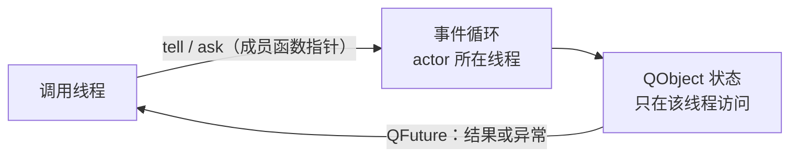
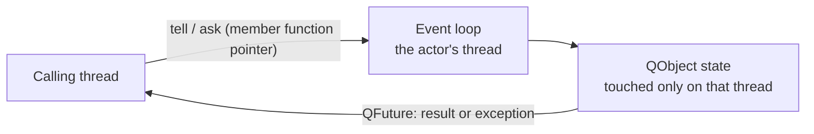

# qactor

[中文](#中文) · [English](#english)

## 中文

qactor 是一个基于 Qt 6 的 C++17 actor 风格执行库：actor 就是普通 `QObject`，被放到某条线程上钉住，所有消息在那条线程上串行执行，所以内部不需要加锁。

actor 可以是任何一个 `QObject` ：

```cpp
class Calculator final : public QObject
{
public:
    explicit Calculator(int initial = 0) : m_value(initial) {}
    int add(int operand) { m_value += operand; return m_value; }
    int multiply(int operand) { m_value *= operand; return m_value; }
    int value() const { return m_value; }
private:
    int m_value = 0;
};
```

把它搬到某条线程上，`spawn<T>()` 直接给出 `ActorRef<T>`，此后都通过句柄发消息：

```cpp
QThread worker;                                                   // 你自己开的一条线程
worker.start();

ActorRef<Calculator> calc = actor::spawn<Calculator>(&worker, 0);  // 造 actor，搬上去

calc.tell<&Calculator::add>(2);                                    // 发消息，不等结果
int v = calc.ask<&Calculator::value>().result();                   // 取结果：QFuture<int>
calc.ask<&Calculator::multiply>(5).then(&app, ...);                // 也可以异步消费
```

消息是这样走的：



核心只有一件事，其余都是它的支撑：

- **`ActorRef<T>`** —— actor 的句柄，也是发消息的唯一入口。`ask<&T::method>(args...)` 取结果，`tell<&T::method>(args...)` 不等结果；两者进同一条队列，混用时投递顺序仍然成立。返回什么由方法的返回类型决定：返回普通值 `R` 得到 `QFuture<R>`；方法本身返回 `QFuture<X>` 时自动展平一层，适合「要等外部回包才完成」的事务。
- **`async::tell` / `async::ask`** —— 底下的投递层：把一段可执行体丢到 `QObject` 所属线程的事件循环上跑。越过 `ActorRef` 直接用它投递也可以。
- **actor 落在哪条线程上由你选** —— `spawn<T>(&thread, ...)` 把对象搬到那条线程并返回句柄，对象之后不再迁移；目标线程还没 `start()` 也行，消息会先排队。想连线程一起打包可以用辅助类 `ActorThreaded<T>`，它析构时负责对象 `deleteLater` 与线程 `quit()` + `wait()`。这些都不依赖线程池。

**额外功能：共享线程池**（`threadpool.h`）—— 想把 N 个 actor 均摊到几条线程上以省线程数时才需要：`Init(n)` 起线程，`spawnOnSharedPool<T>()` 轮转搬上去并登记，`Shutdown()` 停线程并销毁登记过的 actor。不用它也能正常写 actor。注意它不是任务线程池，见下面第一条。

几点容易踩的：

- 共享池**不是**任务线程池：对象长期存活、钉死在某条线上，同一条线上多个 actor 互相串行，一个卡住会拖住另一个。要并行跑一堆独立小任务请用 `QtConcurrent::run` / `async::run`，不要走 actor。

### 示例

- [`examples/counter.cpp`](examples/counter.cpp)：`Calculator` 是个普通 `QObject`，加减乘除各自返回更新后的值。示例以 `ActorThreaded` 起独占线程版，`tell` 与 `ask` 混发验证顺序保证，除零异常经 future 回到调用方，结果用 `then()` 交回主线程消费；末尾顺带演示了共享池版 `spawnOnSharedPool`。

---

## English

qactor is a small C++17 actor-style execution library built on Qt 6. An actor is placed on a thread and pinned there, so every message runs serially on that thread and the actor needs no locking.

An actor can be any `QObject`:

```cpp
class Calculator final : public QObject
{
public:
    explicit Calculator(int initial = 0) : m_value(initial) {}
    int add(int operand) { m_value += operand; return m_value; }
    int multiply(int operand) { m_value *= operand; return m_value; }
    int value() const { return m_value; }
private:
    int m_value = 0;
};
```

Move it onto a thread and `spawn<T>()` hands back an `ActorRef<T>`; from then on everything goes through the handle:

```cpp
QThread worker;                                                   // a thread of your own
worker.start();

ActorRef<Calculator> calc = actor::spawn<Calculator>(&worker, 0);  // build the actor, move it there

calc.tell<&Calculator::add>(2);                                    // send a message, no result
int v = calc.ask<&Calculator::value>().result();                   // send and wait: QFuture<int>
calc.ask<&Calculator::multiply>(5).then(&app, ...);                // or consume it asynchronously
```

How a message travels:



One core idea, with everything else supporting it:

- **`ActorRef<T>`** — the handle to an actor, and the only way to send one a message. `ask<&T::method>(args...)` returns a result, `tell<&T::method>(args...)` does not; both enter the same queue, so ordering holds when they are mixed. What comes back depends on the method: a plain `R` yields `QFuture<R>`, while a method returning `QFuture<X>` is flattened — handy for transactions that complete on some external reply.
- **`async::tell` / `async::ask`** — the dispatch layer underneath: hand a callable to the event loop that owns some `QObject`. You can bypass `ActorRef` and post through them directly.
- **Where an actor lives is your choice** — `spawn<T>(&thread, ...)` moves the object onto that thread and returns the handle; the object never migrates afterwards, and the thread need not be `start()`ed yet (messages queue up). If you want the thread bundled along with it, the `ActorThreaded<T>` helper does that and takes care of `deleteLater` on the object and `quit()` + `wait()` on the thread when it is destroyed. None of this depends on the thread pool.

**Optional extra: the shared thread pool** (`threadpool.h`) — only needed when you want N actors spread over a few threads to save threads: `Init(n)` starts them, `spawnOnSharedPool<T>()` round-robins the object onto one and registers it, `Shutdown()` stops the threads and destroys the registered actors. Actors work fine without it, and it is not a task pool — see the first caveat below.

Worth knowing before you use it:

- The shared pool is **not** a task thread pool: actors are long-lived and pinned, several actors on one thread run one after another, and a slow one blocks its neighbours. For piles of independent small jobs use `QtConcurrent::run` / `async::run` instead of actors.

### Examples

- [`examples/counter.cpp`](examples/counter.cpp): `Calculator` is a plain `QObject` whose add, subtract, multiply and divide return the updated value. The example runs the dedicated-thread form (`ActorThreaded`), mixes `tell` and `ask` to show ordering, lets a division by zero reach the caller through the future, and consumes a result on the main thread with `then()`; the pooled form (`spawnOnSharedPool`) appears at the end as a bonus.

---

## Requirements

- CMake
- A C++17 compiler
- Qt 6 or newer (`Core`; `Test` when `BUILD_TESTING` is enabled)

## Build and test

```sh
cmake -S . -B build
cmake --build build
ctest --test-dir build --output-on-failure
```

If Qt is not in a standard location, pass its installation prefix with `-DCMAKE_PREFIX_PATH=/path/to/Qt`.

The example is always built; the test target follows the standard `BUILD_TESTING` switch, so pass `-DBUILD_TESTING=OFF` to skip it.

## Contributing

Bug reports and focused pull requests are welcome. The project uses the MIT License; contributions are submitted under the same terms.

## License

[MIT](LICENSE)
